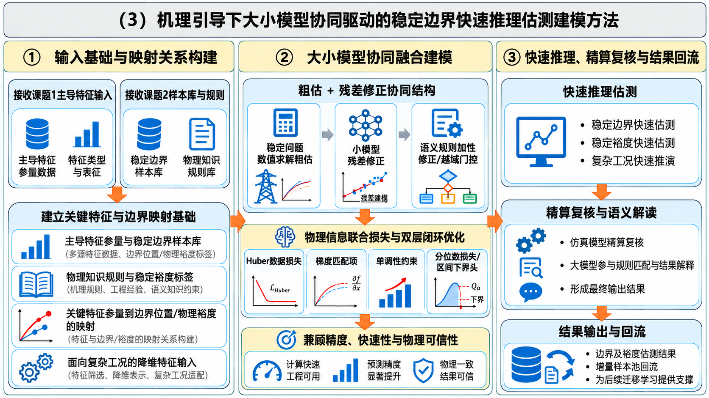
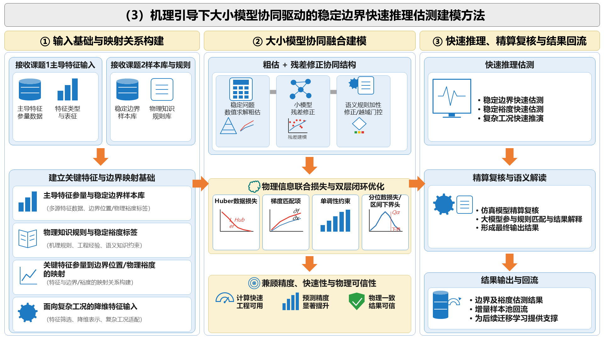

# image2pptx-native

**将图片/截图/PPT页面截图转换为全矢量可编辑 PPTX** — 纯 `python-pptx` 实现，零外部依赖。

<p align="center">
  
  
  <br/>
  <sub>左：源图 &nbsp;|&nbsp; 右：生成的可编辑 PPTX 渲染结果</sub>
</p>

## ✨ 特性

- **100% 矢量可编辑** — 所有文字为原生文本框，所有图形为原生 PPT 形状/自由形状
- **0 张位图** — 图标全部用 MSO 形状程序化绘制（数据库、齿轮、漏斗、盾牌、王冠等）
- **零外部依赖** — 仅需 `python-pptx`，不需要 `@oai/artifact-tool`、Codex Cloud、LibreOffice
- **完全离线** — 本地任意机器运行，无需网络
- **AI Agent Skill** — 可作为 DSH / Codex / Claude Code 等 AI 编码助手的 skill 使用
- **像素级坐标映射** — 1920×1080 画布自动映射到 13.333×7.5 英寸标准 16:9 幻灯片
- **PowerPoint COM 渲染验证** — 可选的本地渲染预览，迭代修正直到满意

## 🚀 快速开始

### 安装

```bash
pip install python-pptx
```

### 作为 AI Agent Skill 使用

将本仓库克隆到你的 skills 目录：

```bash
# DSH (DeepSeek Harness)
git clone https://github.com/YOUR_USERNAME/image2pptx-native.git ~/.agents/skills/image2pptx-native

# Codex CLI
git clone https://github.com/YOUR_USERNAME/image2pptx-native.git ~/.codex/skills/image2pptx-native

# Claude Code
git clone https://github.com/YOUR_USERNAME/image2pptx-native.git ~/.claude/skills/image2pptx-native
```

然后对 AI 说：**"把这张图片转成可编辑PPT"**，AI 会自动加载此 skill 并按工作流执行。

### 手动使用

```bash
# 1. 编写设计脚本（参考 examples/ 中的示例）
python gen_manifest.py

# 2. 构建 PPTX
python scripts/build_pptx.py --manifest manifest.json --output output.pptx

# 3.（可选）PowerPoint COM 渲染验证
powershell -File render.ps1 -pptx output.pptx -png preview.png
```

## 📐 工作原理

```
源图片 → AI视觉分析版式 → gen_manifest.py → manifest.json → build_pptx.py → output.pptx
                                                                    ↓
                                                          PowerPoint COM 渲染验证
```

### 核心架构

| 组件 | 说明 |
|------|------|
| `gen_manifest.py` | 设计脚本 — 用 helper 函数描述每个元素的位置、大小、颜色、文字 |
| `manifest.json` | 中间格式 — 像素坐标的元素列表，跨项目复用 |
| `build_pptx.py` | 通用构建器 — 读取 manifest 生成原生 PPTX（不要修改） |

### 支持的元素类型

| 类型 | 说明 | 示例 |
|------|------|------|
| `shape` | 任意 MSO 自动形状 | 圆角矩形、箭头、圆柱、齿轮、大括号、云形等 |
| `line` | 连接线 | 图标内部线条、坐标轴 |
| `freeform` | 自由形状 | 盾牌、漏斗、王冠、曲线、书页等 |
| `text` | 多段落文本框 | 标题、正文、bullet 列表 |
| `background` | 幻灯片背景 | 纯色填充 |

### 内置图标库

20+ 种程序化绘制的矢量图标：

| 图标 | 函数 | 图标 | 函数 |
|------|------|------|------|
| 🗄️ 数据库 | `icon_db()` | 📊 柱状图 | `icon_bars()` |
| 📄 文档 | `icon_doc()` | 🖥️ 监视器 | `icon_monitor()` |
| 🔗 网络 | `icon_network()` | 🧠 脑/AI | `icon_brain()` |
| 📖 书本 | `icon_book()` | 💨 风机 | `icon_turbine()` |
| 🛡️ 盾牌 | `icon_shield()` | 👑 王冠 | `icon_crown()` |
| 🔽 漏斗 | `icon_funnel()` | ⚙️ 齿轮 | `icon_gear()` |
| 📈 折线图 | `icon_linechart()` | ✅ 清单 | `icon_checklist()` |
| 🔋 直流 | `icon_dc()` | 🥧 饼图 | `icon_pie_red()` |
| 📋 剪贴板 | `icon_clipboard()` | 📉 曲线图 | `icon_curves()` |
| 🧮 计算器 | `icon_calculator()` | 🎯 靶心 | `icon_target()` |
| 🏎️ 速度表 | `icon_speedometer()` | 🛡️✅ 盾牌勾 | `icon_shield_check()` |
| 🔄 循环DB | `icon_cycle_db()` | 📊 散点图 | `icon_scatter()` |
| ◇ 决策 | `icon_decision()` | 📊 分布曲线 | `icon_dist_curve()` |
| 📉 Huber | `icon_huber()` | 📊 单调柱 | `icon_mono_bars()` |
| 📈 梯度 | `icon_grad_curve()` | ⬇️ 下箭头 | `down_arrow()` |
| ➡️ 灰箭头 | `right_arrow_gray()` | | |

## 📁 项目结构

```
image2pptx-native/
├── SKILL.md                    # AI Agent Skill 定义文件
├── README.md                   # 本文件
├── LICENSE                     # MIT License
├── scripts/
│   └── build_pptx.py          # 通用 manifest→PPTX 构建器
└── examples/
    ├── tech_flowchart_1/       # 示例1：稳定边界主导特征参量辨识技术
    │   ├── gen_manifest.py     #   设计脚本
    │   ├── original_inputs/    #   源图
    │   └── diagnostics/        #   渲染预览
    └── tech_flowchart_2/       # 示例2：快速推理估测建模方法
        ├── gen_manifest.py
        ├── original_inputs/
        └── diagnostics/
```

## 🎨 自定义扩展

### 添加新图标

在 `gen_manifest.py` 中定义新的 helper 函数，组合基础原语即可：

```python
def icon_my_custom(x, y, w, h, color=ICON_BLUE):
    # 组合 shape + line + freeform
    shape("ROUNDED_RECTANGLE", x, y, w, h, fill=color, adj=0.15)
    line(x + 0.2*w, y + 0.5*h, x + 0.8*w, y + 0.5*h, "FFFFFF", 2)
    freeform([(0.3, 0.2), (0.7, 0.2), (0.5, 0.8)], x, y, w, h, fill="FFFFFF")
```

### 可用的 MSO 形状

支持所有 `MSO_AUTO_SHAPE_TYPE` 枚举值：
`RECTANGLE`, `ROUNDED_RECTANGLE`, `OVAL`, `CAN`, `GEAR_9`, `FUNNEL`,
`RIGHT_BRACE`, `LEFT_BRACE`, `DOWN_ARROW`, `RIGHT_ARROW`, `CLOUD`,
`LIGHTNING_BOLT`, `ISOSCELES_TRIANGLE`, `PENTAGON`, `DONUT`, `PIE`,
`CHEVRON`, `ARC`, `BLOCK_ARC`, `DIAMOND`, `HEXAGON`, `TRAPEZOID` 等。

## 📊 与 artifact-tool 方案对比

| | image2pptx-native | @oai/artifact-tool |
|---|---|---|
| **依赖** | python-pptx (pip install) | @oai/artifact-tool (私有包) |
| **运行环境** | 本地任意机器 | Codex Cloud 沙箱 |
| **网络需求** | 无 | 需要 OpenAI API |
| **图标** | 原生形状程序化绘制 | 同 |
| **文字** | 原生文本框 | 同 |
| **位图** | 0 张 | 0 张 |
| **渲染验证** | PowerPoint COM (可选) | 内置 skia-canvas |
| **离线使用** | ✅ | ❌ |
| **成本** | 免费 | 需要 ChatGPT Plus/Pro |

## 📄 License

MIT License — 详见 [LICENSE](LICENSE)

## 🙏 致谢

本项目的工作流灵感来源于 OpenAI Codex 的 `@oai/artifact-tool` Presentation API 和 `bggg-creator-image2ppt` skill。通过将核心构建逻辑提取为纯 `python-pptx` 实现，实现了完全本地化、零依赖的图片→可编辑PPTX转换能力。
